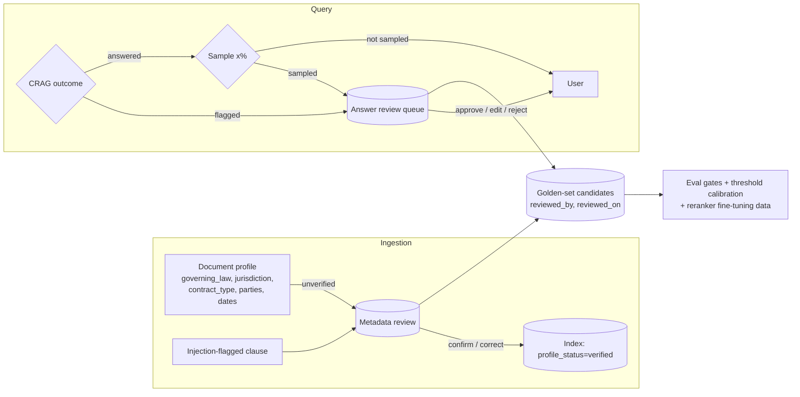

# Final architectural review — 2026-09-23

Scope: the current working tree (250 tests passing, 3 skipped), compared against
four comparable open-source systems and the research on legal RAG and
human-in-the-loop (HITL) review. Earlier findings (B1–B5, S1–S6, L1–L19) are in
`CLAUDE.md`; this document covers the architecture as a whole, and HITL in
particular.

## 1. Verdict

The **answer-safety core is stronger than every comparable open-source system
reviewed**. Every claim must come with a verbatim quote from the contract, that
quote is checked by string match, and the answer text is built only from
validated claims. Tenant isolation is enforced at several layers. The retrieval
stack is standard and supported by the evidence (clause-aware chunks, hybrid
search with RRF, contextual summaries).

Four gaps are architectural rather than local bugs. They matter more than any
remaining retrieval tuning:

1. **Human-in-the-loop exists only as a label.** `flagged_for_review` routes to
   `END`. There is no queue, no case ID, no persisted state, no reviewer API, and
   no way for a review decision to flow back into the system. The design
   promises "flag for attorney review", but nothing receives the flag. (§4)
2. **Correctness is still unmeasured end to end.** Only BM25 retrieval has
   numbers. Hybrid and dense retrieval, generation quality, the false-refusal
   rate, and the unanswerable-question rate have no measurements, and the golden
   set has not been reviewed. The system is *designed* to be safe; it is not yet
   *shown* to be.
3. **Citations don't survive a re-ingest.** `clause_id` is positional
   (`doc::clause-007`) and re-ingest deletes and rewrites. After a contract is
   revised, a clause ID in a past answer or audit record points to *different
   text*. For a legal audit trail, that is a correctness bug.
4. **Only single-document queries are supported.** Portfolio questions such as
   "which of our contracts have uncapped liability?" are the core
   contract-review task in CUAD-style work, and the architecture can't express
   them.

## 2. Comparison against comparable systems

| Capability | This repo | [lex-rag](https://github.com/sangowu/lex-rag) | [Self-Correcting Legal RAG](https://github.com/rohitpeets/A-Self-Correcting-Legal-Research-System) | [ClauseLens-RAG](https://github.com/chamakura-lokesh-mudhiraj/ClauseLens-RAG) | [OpenContracts](https://github.com/Open-Source-Legal/OpenContracts) |
|---|---|---|---|---|---|
| Chunking | Clause-aware + passage split within clause | Recursive 1000/100 + parent-child 1000/300 | Sentence-based with overlap | Clause-aware (beat fixed-size by ~9pp hit@1 on BM25) | Human span annotation |
| Hybrid retrieval | Dense + BM25Plus (in memory, per document), RRF | Dense BGE-M3 + Postgres tsvector, RRF | MiniLM + BM25Okapi, RRF k=60 | Dense + BM25, RRF | Vector search |
| Reranker | Cohere, **on by default**, not ablated | bge-reranker-v2-m3, toggleable, measured | ms-marco MiniLM cross-encoder | — | — |
| Grounding check | **Deterministic verbatim quote + numbers/negation + optional NLI** | Citation offsets + verbatim excerpt ("non-defensive" by its own description) | Second LLM call as judge | Prompt instruction only | Human annotation is ground truth |
| Unsupported claims | **Stripped; answer rebuilt from validated claims** | First-class `refused` flag | Abstains if the judge fails | — | — |
| Jailbreak / injection | Prompted LLM + ingestion regex scan | Prompt rule + injection-probe release gate | **Llama Prompt Guard 2 (86M)**, dedicated | — | — |
| Multi-tenancy | Scoped keys, tenant-scoped point IDs, pre- and post-filter | API keys; **refuses to start on non-loopback without keys** | — | — | Permissioned corpora |
| Source versioning | Delete then rewrite (no versions) | SHA-256 fingerprint per document at ingest | — | — | **Cited versions preserved across document updates** |
| Eval | CUAD BM25 within-document; golden gate (unreviewed) | Retrieval + generation (false-answer / false-refusal) + release gates | 41 questions, 1 contract | 510 CUAD docs, hit@k | — |
| **HITL** | Status flag only | None | None (10 hand-labelled router questions) | None | **Approve/reject on every extracted cell; humans accept agent-proposed edges** |

**About the numbers.** Your BM25 hit@5 is .690 (`eval/retrieval/cuad_recall.py`).
lex-rag reports .819 (hybrid + rerank) and ClauseLens .675 (hybrid). **These are
not comparable:** your eval searches *within the one correct contract*
(invariant #9), which is much easier than searching across a corpus. The
comparable figure you're missing is hybrid within-document, and later a
corpus-wide run if A4 is built.

**What the comparison supports keeping.** Clause-aware chunking (ClauseLens
+9pp hit@1). JSON-structured refusal as a first-class output (lex-rag). The
deterministic validator: the Self-Correcting repo found hybrid retrieval gave
the *highest* recall@10 (.79) but the *lowest* citation accuracy (.20).
Retrieving the right chunk does not mean citing it correctly, which is exactly
the gap your validator closes.

## 3. Architectural gaps, ranked

| # | Gap | Evidence | Recommendation |
|---|---|---|---|
| A1 | HITL is a dead end (§4) | `crag_graph.py`: `flag_for_review → END`. No `query_id`, no checkpointer, no reviewer endpoints. `QueryResponse` carries no evidence. | Build the review workflow in §4. |
| A2 | Correctness unmeasured end to end | Only BM25 has numbers. Golden set unreviewed. False-refusal rate unknown, and L19 shows the validator rejects some correct claims. | Hybrid within-document recall. Golden set with **unanswerable questions** and **injection probes** as release gates (lex-rag re-runs each probe 3× per gate). Report false-answer and false-refusal rates separately. CUAD categories with no answer in a document give free unanswerable cases. |
| A3 | Citations aren't version-stable | Positional `clause_id` plus delete-then-write. Nothing stores a content hash or document version. | Add `document_version` = SHA-256 of normalized source text, stored in the payload and returned in `CitationOut`. Keep superseded versions (soft delete, `is_current=false`, filtered out at query time). Skip re-embedding when the hash is unchanged. This is also the foundation for R11 (amendments / supersession). OpenContracts preserves cited versions for this reason. |
| A4 | Single-document scope only | Invariant #9. The eval notes that DRM "can't occur by construction". | Add a separate **matter-search route**: a retrieval-only, document-level ranking of which contracts match, with no generated answer. Then per-document answering reuses today's pipeline. Once it exists, DRM (>95% on NDAs, arXiv:2510.06999) matters again, and the summary prefix you already store is the known mitigation. |
| A5 | Auth fails open | Empty `API_KEYS` means unauthenticated on any bind address. | Fail closed: refuse to start when `API_KEYS` is empty unless `DEV_MODE=true` and the host is loopback (lex-rag does this). |
| A6 | Reranker on by default against the evidence | `RERANK_ENABLED=true`. LegalBench-RAG: Cohere reranking hurt. Topollai et al. 2025: a pretrained BGE reranker cut top-1 from 55.98% to **12.31%**; only a reranker fine-tuned with graded labels helped (58.93%). | Default **off** until the R3 ablation shows a gain. Longer term, fine-tune a reranker on reviewer decisions from §4. |
| A7 | Jailbreak classifier depends on the same provider as the generator | Prompted LLM on Groq. | Use a dedicated guard model such as Llama Prompt Guard 2 (86M), as the Self-Correcting repo does: cheap, gives a scalar score, and has a threshold you can tune. |
| A8 | Serial LLM calls per query | Jailbreak → router → sufficiency → generate, plus up to 2 retries: 4–7 serial calls. | Log per-stage latency in the trace. Run the jailbreak and router calls in parallel, since they are independent. |

## 4. Human-in-the-loop

### 4.1 What the research and the field say

- **A human is not optional.** ABA Formal Opinion 512 (July 2024) requires
  lawyers to review and verify AI output and to supervise the tools they use.
  Magesh et al. (2025) measured 17–33% hallucination in *commercial* legal RAG
  tools. Your disclaimer says "requires attorney review", so the architecture
  needs somewhere for that review to happen.
- **A human can be a weak check if the workflow is designed badly.** Oversight
  studies (arXiv:2507.19486) find that reviewers over-accept outputs from a
  system that is "correct most of the time". Passive accuracy warnings had
  little effect. What helped was *active* engagement: asking reviewers to look
  for errors, highlighting where the output deviates, and requiring an explicit
  judgement. Magesh et al. also note that a fabricated authority looks exactly
  like a real one.
- **Route by calibrated confidence, and measure the auto-decided error.**
  Deterministic Fuzzy Triage (arXiv:2603.07390) uses a three-way split
  (auto-accept / auto-reject / human review) with thresholds tuned to keep
  auto-decided error at or below **2%**. It auto-decided **98.6%** of clauses
  with **1.15%** error in that region. The key point is that the error rate of
  what is *not* reviewed is an explicit, measured budget.
- **Uncertain cases are where humans add value, and their decisions become
  training data.** Topollai et al. (arXiv:2511.14671, NYU and Con Edison) keep
  the legal expert in the loop for edge cases and high-stakes clauses. Their
  classifier's errors concentrated in low-confidence predictions, which made
  those predictions the right ones to route to experts. They also used lawyers'
  tracked edits as labels.
- **OpenContracts** is the one open-source legal platform with HITL built in.
  Humans approve or reject every extracted cell and accept agent-proposed links.
  It treats human annotation as ground truth.
- **None of the three comparable RAG repos has HITL.** This is a place where
  the project can be ahead of the field rather than catching up.

### 4.2 Where HITL belongs in this system

**H1 — Answer review queue (fixes A1).** This is the minimum viable HITL.
- Return a `query_id` on every response. Persist CRAG state with the LangGraph
  checkpointer (`langgraph-checkpoint-postgres` is already installed) and
  replace the terminal flag node with `interrupt()`. A review then *resumes* the
  graph instead of starting it again.
- Add endpoints: `GET /reviews?status=open` (scoped to matter),
  `GET /reviews/{id}`, and `POST /reviews/{id}/decision`.
- Each case includes an **evidence packet**: the question, route, retrieval
  trace, each clause shown to the model (with injection flags), and each draft
  claim with its quote and the validator's `failure_reason`.
- Decisions: **approve** (per claim), **edit**, **reject**, or
  **re-retrieve with a hint**.
- **Edits go back through the citation validator.** A reviewer can override a
  failing check only by recording a reason. Overrides are audited, so the
  invariant "every claim returned is grounded or explicitly signed off" still
  holds.

**H2 — Designed against automation bias.** Per the oversight research:
- Approve **claim by claim**. There is no "approve all" button.
- Put validator failures and deviations first (number or negation mismatches,
  injection-flagged clauses).
- Require a reason for every override.
- Record who decided and when, and how long they took (a signal of
  rubber-stamping).
- Seed a small rate of known-bad claims to measure reviewer catch rate. This is
  the only way to know whether the review is doing anything.

**H3 — Sampled audit of `answered` results.** Send x% of auto-answered
responses to the same queue. Without it you cannot measure the error rate of
what is *not* reviewed, which is the number that matters (the triage paper's
≤2% budget). Use the results to calibrate the sufficiency and validator
thresholds, and the NLI threshold (R6).

**H4 — Metadata review at ingestion.** `governing_law`, `jurisdiction` and
`contract_type` drive *filters*, so an LLM extraction error hides a contract
silently: the filter returns nothing and the query looks like "no such
contract". Store `profile_status: unverified | verified`, and queue documents
for confirmation in the style of OpenContracts' per-cell approve/reject. Put the
low-confidence cases first: the profile disagrees with clause-level tags, the
gazetteer found no match, or two states are named. While filtered queries still
depend on unverified metadata, the response should say so.

**H5 — Close the loop.** Every reviewed decision becomes a golden-set candidate
with `reviewed_by` and `reviewed_on`. The review queue is the cheapest way to
reach the 40+ lawyer-reviewed items that `is_certifiable()` requires (R2). Those
decisions also feed threshold calibration (H3) and are the graded labels a
fine-tuned reranker needs (A6).

**HITL metrics to track:** queue rate by reason; reviewer approve / edit /
reject rates; override rate; catch rate on seeded errors; median time to
decision; and error rate on the sampled auto-answered results.

## 5. Recommended sequence

1. **A5** fail-closed auth and **A6** reranker default off. Config-level changes.
2. **H1 + H2** answer review queue with evidence packet, per-claim decisions and
   audited overrides.
3. **A3** versioned documents and citations. Needed before reviewer decisions
   that reference clause IDs are stored long term.
4. **A2 + H3 + H5** end-to-end eval with unanswerable and injection gates,
   sampled audits, and reviewed decisions flowing into the golden set.
5. **H4** metadata review. Then **A4** matter-wide search, and **A7** a
   dedicated guard model.

## Sources

- Pipitone & Alami, *LegalBench-RAG*, arXiv:2408.10343
- Reuter et al., *Towards Reliable Retrieval in RAG Systems for Large Legal Datasets*, arXiv:2510.06999
- Topollai et al., *Streamlining Industrial Contract Management with Retrieval-Augmented LLMs*, arXiv:2511.14671
- *Deterministic Fuzzy Triage for Legal Compliance Classification and Evidence Retrieval*, arXiv:2603.07390
- *Confirmation bias: A challenge for scalable oversight*, arXiv:2507.19486
- Magesh et al., *Hallucination-Free?*, Journal of Empirical Legal Studies (2025)
- Martin et al., *Better Call GPT, Comparing Large Language Models Against Lawyers*, arXiv:2401.16212
- Choi, Monahan & Schwarcz, *Lawyering in the Age of Artificial Intelligence*, Minnesota Law Review (2024)
- ABA Formal Opinion 512, *Generative Artificial Intelligence Tools* (2024)
- LangGraph interrupts: docs.langchain.com/oss/python/langgraph/interrupts
- Repos: sangowu/lex-rag, rohitpeets/A-Self-Correcting-Legal-Research-System, chamakura-lokesh-mudhiraj/ClauseLens-RAG, Open-Source-Legal/OpenContracts
